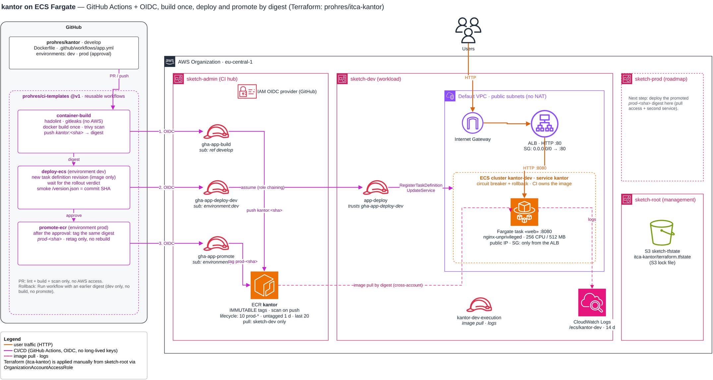

# itca-kantor

Infrastructure for the [kantor](https://github.com/prohres/kantor) static site: a container on ECS Fargate
behind an Application Load Balancer, images in a shared ECR registry. Built and deployed by GitHub Actions
with OIDC (no long-lived AWS keys), using reusable workflows from
[ci-templates](https://github.com/prohres/ci-templates).

## Before → after

This repo started as a course final project (tag `legacy-codepipeline`, the old diagram is `itca-kantor.png` in that tag).

| | Before (`legacy-codepipeline`) | After |
|---|---|---|
| Terraform | 0.11 syntax, `profile = "default"` | ≥ 1.10, credentials from the environment, `allowed_account_ids`, S3 backend with lock file |
| CI/CD | CodePipeline v1 → CodeBuild → ECS, GitHub via OAuth token | GitHub Actions, OIDC role per pipeline stage |
| Image | pushed as `:latest` + short SHA (mutable tags) | built once, `IMMUTABLE` tags, deployed and promoted by digest |
| Accounts | one account | registry in the CI hub (sketch-admin), runtime in a workload account (sketch-dev) |
| Network | own VPC + NAT | default VPC, public subnets, no NAT (demo); tasks reachable only from the ALB |

## Architecture



Source: [`itca-kantor.drawio`](itca-kantor.drawio) (draw.io); re-export the PNG after every change.

## Pipeline

```
kantor PR      → lint · secret scan · build · image scan            (no AWS access)
kantor develop → build once → push ECR kantor:<sha>
               → deploy dev (ECS, new task definition revision) → smoke test
               → prod environment approval → tag the same digest prod-<sha>
```

Rollback: re-run the deploy with an earlier digest; a deploy that never gets healthy is rolled back by the
ECS deployment circuit breaker.

## Layout (`terraform/`)

| File | What |
|---|---|
| `versions.tf` | providers: sketch-dev (default) and sketch-admin (`admin`), both via `OrganizationAccountAccessRole` |
| `ecr.tf` | registry, lifecycle policy, pull access for workload accounts |
| `network.tf` | default VPC lookup, security groups (ALB :80 → tasks :8080) |
| `alb.tf` | load balancer, target group, HTTP listener |
| `ecs.tf` | cluster, logs, execution role, task definition, service |
| `deploy_role.tf` | `app-deploy`: the only role CI uses in sketch-dev |

## Design decisions

| Decision | Why |
|---|---|
| Registry in the CI hub, not in a workload account | every environment pulls the same digest; prod never depends on the dev account |
| Lifecycle: keep 10 `prod-*`, drop untagged after 1 day, keep the last 20 builds | promoted images stay available for rollback; a higher-priority rule protects them from the catch-all rule |
| CI owns the task definition (`ignore_changes`), Terraform creates the service with a placeholder image | otherwise every `terraform apply` would roll the service back to the image in code |
| `app-deploy` can update this one service and pass only the execution role to `ecs-tasks` | CI rolls out new revisions but can't change the infrastructure or hand the service another role |
| Public IP on tasks instead of NAT | NAT costs more than the whole demo; the task security group accepts traffic only from the ALB |
| Every checkov skip has a reason inline | HTTP without TLS, no WAF / access logs: accepted for the demo, listed in the roadmap |

## Apply (manual)

```bash
cd terraform
AWS_PROFILE=sketch-root terraform init -backend-config=backend.hcl
AWS_PROFILE=sketch-root terraform plan -out=app.tfplan
AWS_PROFILE=sketch-root terraform apply app.tfplan
terraform output url
```

## Roadmap

- [ ] prod environment in sketch-prod (pull access + second service)
- [ ] scale to zero / destroy from CI between sessions
- [ ] HTTPS: domain + ACM certificate
- [ ] own VPC with private subnets
- [ ] Terraform CI for this repo (plan on PR, apply after approval)
- [x] architecture diagram (`itca-kantor.drawio`) for the new setup
