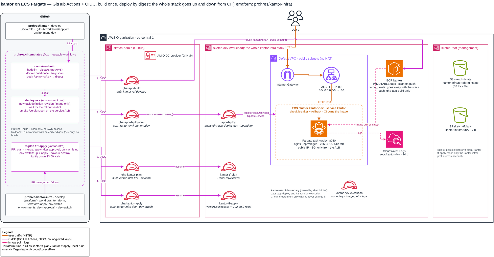

# kantor-infra

Infrastructure for the [kantor](https://github.com/prohres/kantor) static site: a container on ECS Fargate
behind an Application Load Balancer, images in ECR, all in one account (sketch-dev). The whole stack is created
and destroyed from GitHub Actions (up / down, nightly down); built and deployed with OIDC (no long-lived AWS
keys), using reusable workflows from [ci-templates](https://github.com/prohres/ci-templates).

## Before → after

This repo started as a course final project, renamed from `itca-kantor` (tag `legacy-codepipeline`, the old diagram is `itca-kantor.png` in that tag).

| | Before (`legacy-codepipeline`) | After |
|---|---|---|
| Terraform | 0.11 syntax, `profile = "default"` | ≥ 1.10, credentials from the environment, `allowed_account_ids`, S3 backend with lock file |
| CI/CD | CodePipeline v1 → CodeBuild → ECS, GitHub via OAuth token | GitHub Actions, OIDC role per pipeline stage |
| Image | pushed as `:latest` + short SHA (mutable tags) | built once, `IMMUTABLE` tags, deployed by digest |
| Accounts | one account | CI identity in the CI hub (sketch-admin), the whole stack in a workload account (sketch-dev) |
| Network | own VPC + NAT | default VPC, public subnets, no NAT (demo); tasks reachable only from the ALB |

## Architecture



Source: [`architecture.drawio`](architecture.drawio) (draw.io); re-export the PNG after every change.

## Pipeline

```
kantor PR      → lint · secret scan · build · image scan            (no AWS access)
kantor develop → build once → push ECR (sketch-dev) kantor:<sha>
               → deploy dev (ECS, new task definition revision) → smoke test
```

Rollback: re-run the deploy with an earlier digest; a deploy that never gets healthy is rolled back by the
ECS deployment circuit breaker. After a down the registry is gone, so only builds since the last up can be
rolled back to.

## Up / down

| Workflow | When | What |
|---|---|---|
| `env-switch` | Actions → Run workflow: `up` / `down` | `up`: plan → apply the whole stack; then run kantor → app to build and deploy. `down`: plan `-destroy` → destroy everything, registry and images included |
| `env-switch` | daily 23:00 Europe/Kyiv | `down`; a stack that is already down is a no-op |
| `terraform` | pull request | plan as a PR comment (tflint + checkov first, no AWS access) |
| `terraform-apply` | merge to `develop` | stack up: plan → approval in `dev` → apply. Stack down: nothing; the next `up` applies this commit |

Up / down and the nightly down run in the `dev-switch` environment (no reviewers: the click or the schedule
is the decision); a merge goes through `dev` (required reviewer). All of them share one concurrency group.

## Layout (`terraform/`)

| File | What |
|---|---|
| `versions.tf` | one provider, sketch-dev; credentials from the environment (the CI role in CI, `assume_role_name` locally) |
| `ecr.tf` | registry (`force_delete`: goes away with the stack), lifecycle policy, push access for the CI build role |
| `network.tf` | default VPC lookup, security groups (ALB :80 → tasks :8080) |
| `alb.tf` | load balancer, target group, HTTP listener |
| `ecs.tf` | cluster, logs, execution role (with the permissions boundary), task definition, service |
| `deploy_role.tf` | `app-deploy`: the role the kantor deploy job uses (with the permissions boundary) |
| `variables.tf` | account ids (validated, no defaults); `assume_role_name` (local runs only); `desired_count`: 1 = on, 0 = app stopped |
| `*.example` | templates for the two local files kept out of git: `accounts.auto.tfvars`, `backend.local.hcl` |
| `.github/workflows/` | `terraform` (PR plan), `terraform-apply` (after merge, only while up), `env-switch` (up / down, nightly down) |
| `.terraform-version`, `.tflint.hcl` | Terraform version for CI, tflint rules (same as sketch-infra) |

## Design decisions

| Decision | Why |
|---|---|
| Registry in sketch-dev, inside this stack | one account per stack: no cross-account hops for Terraform, and down removes everything; images are rebuilt after up |
| Lifecycle: drop untagged after 1 day, keep the last 20 builds | old builds stay available for rollback; the registry never grows without bound |
| CI owns the task definition (`ignore_changes`), Terraform creates the service with a placeholder image | otherwise every `terraform apply` would roll the service back to the image in code |
| `app-deploy` can update this one service and pass only the execution role to `ecs-tasks` | CI rolls out new revisions but can't change the infrastructure or hand the service another role; it may read load balancers to find the smoke URL (Describe only) |
| Public IP on tasks instead of NAT | NAT costs more than the whole demo; the task security group accepts traffic only from the ALB |
| Account ids out of git (local tfvars here, repo variables in CI) | the repos are public; ids aren't secrets, but they are free reconnaissance |
| Whole stack up / down from Actions, nightly down at 23:00 Kyiv | the demo costs money only while it runs; nobody has to remember to switch it off |
| A merge while the stack is down applies nothing | no approval request that would bring the stack up by accident; the next up applies the latest code |
| CI roles and the permissions boundary live in sketch-infra (`ci/`) | down must not delete the roles it runs as; CI here can create the stack's two IAM roles only with a boundary it can't change |
| Every checkov skip has a reason inline | HTTP without TLS, no WAF / access logs: accepted for the demo, listed in the roadmap |

## Local runs

```bash
cd terraform
cp accounts.auto.tfvars.example accounts.auto.tfvars   # fill in the account ids and assume_role_name
cp backend.local.hcl.example backend.local.hcl          # fill in the state bucket
AWS_PROFILE=sketch-root terraform init -backend-config=backend.hcl -backend-config=backend.local.hcl
AWS_PROFILE=sketch-root terraform plan
```

Prefer `env-switch` for up / down: CI runs as narrow roles; a local apply runs as `OrganizationAccountAccessRole`.

## Roadmap

- [ ] HTTPS: domain + ACM certificate
- [ ] own VPC with private subnets
- [x] architecture diagram (`architecture.drawio`): registry in sketch-dev, up / down workflows, CI roles and boundary
- [x] Terraform CI for this repo: plan on PR, apply after approval, up / down and nightly down
